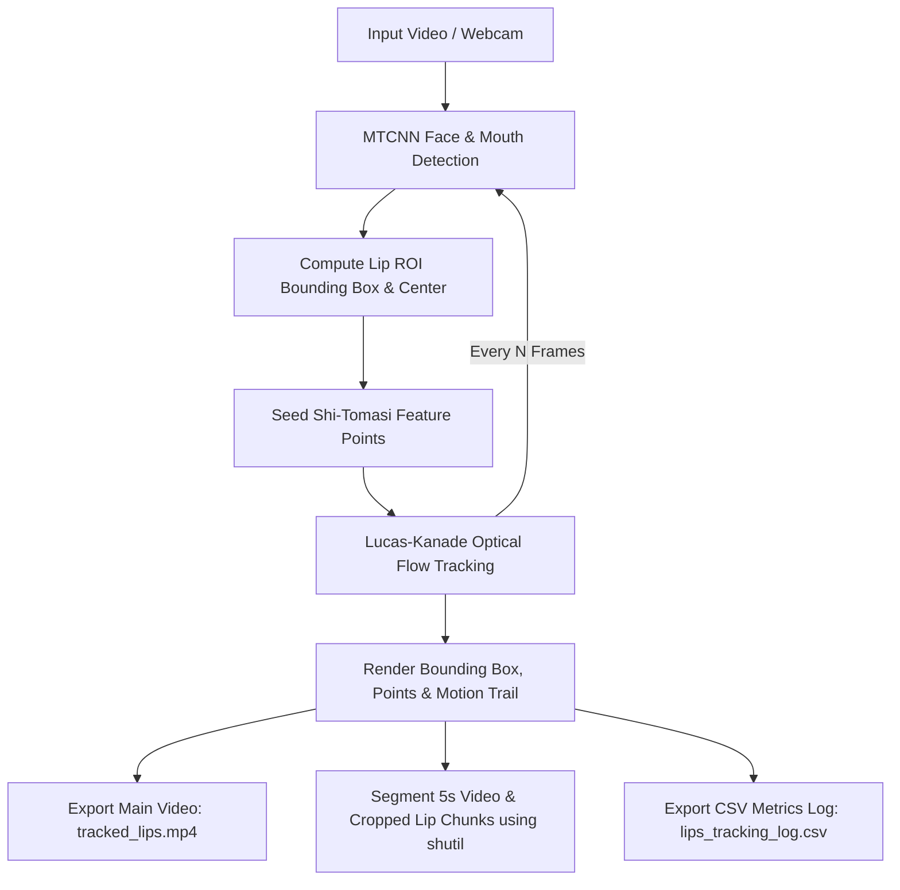

# 👄 MTCNN Lip Tracking & Optical Flow Studio

[](https://www.python.org/)
[](https://opencv.org/)
[](https://pytorch.org/)
[](https://streamlit.io/)
[](#-github-pages-setup)
[](LICENSE)

An end-to-end Computer Vision system for **Lips-Only Detection, Feature Point Seeding, and Lucas-Kanade Optical Flow Tracking**, featuring automated 5-second video archiving using Python `shutil`, structured CSV metrics telemetry, an interactive **Streamlit Web App**, and a **GitHub Pages Live Showcase**.

---

## 🌟 Key Features

- **MTCNN Landmark Detection**: Automatically locates facial structures and extracts exact mouth corner landmarks (`left_corner`, `right_corner`).
- **Shi-Tomasi Feature Point Seeding**: Seeds up to 25 corner tracking points inside the lip Region of Interest (ROI).
- **Hybrid Lucas-Kanade Optical Flow**: High-FPS frame-to-frame optical flow tracking between periodic MTCNN re-detection cycles.
- **5-Second Video Chunking (`shutil`)**: Automatically purges and organizes raw video chunks and cropped lip video chunks, generating ZIP archives on the fly.
- **Structured CSV Telemetry**: Logs frame index, time offset, lip width (px), lip center coordinates (X, Y), and active optical flow points count.
- **Interactive Streamlit Web Studio (`app.py`)**: Real-time browser app with Plotly telemetry analytics, video playback, and live video uploading.
- **GitHub Pages Showcase (`index.html`)**: Beautiful, responsive landing page with video showcase and interactive Chart.js graphs.

---

## 🏗 Pipeline Architecture



---

## 🚀 Quick Start Guide

### 1. Prerequisites & Installation

Clone the repository and install the dependencies:

```bash
git clone https://github.com/username/repository-name.git
cd "Open cv models"

pip install -r requirements.txt
```

### 2. Run the Core Python Script

Run the main detection & tracking script with a video picker GUI or via CLI flags:

```bash
# GUI file picker mode
python track_features.py

# CLI input mode with live preview window
python track_features.py --input sample.mp4 --show --chunk-sec 5.0
```

### 3. Launch the Streamlit Web Application

Launch the interactive Streamlit Web App locally:

```bash
streamlit run app.py
```

Access the app in your browser at `http://localhost:8501`.

---

## 🌐 Live Web Deployment Options

### Option 1: GitHub Pages Live Showcase (Static Showcase)

1. Push your project repository to GitHub:
   ```bash
   git remote add origin https://github.com/username/repository-name.git
   git branch -M main
   git push -u origin main
   ```
2. On GitHub, navigate to **Settings** > **Pages**.
3. Under **Build and deployment** > **Branch**, select `main` and `/ (root)`.
4. Click **Save**. Your live showcase will be live at:
   `https://<username>.github.io/<repository-name>/`

---

### Option 2: Streamlit Community Cloud (Free Interactive App)

1. Sign in to [Streamlit Community Cloud](https://streamlit.io/cloud) with your GitHub account.
2. Click **New app**.
3. Select your GitHub repository (`repository-name`), branch (`main`), and set **Main file path** to `app.py`.
4. Click **Deploy!** Your interactive Web App will be live with a shareable URL.

---

## 📁 Repository Structure

```text
├── track_features.py        # Core MTCNN + Optical Flow tracking pipeline
├── app.py                   # Streamlit Interactive Web Application
├── index.html               # GitHub Pages live showcase landing page
├── styles.css               # Modern dark glassmorphism CSS theme
├── script.js                # Interactive Chart.js telemetry visualization
├── tracked_lips.mp4         # Sample output annotated video
├── lips_tracking_log.csv    # Sample frame-by-frame telemetry log
├── features_log.csv         # Feature point tracking log
├── requirements.txt         # Python package dependencies
├── .gitignore               # Git ignore rules
└── README.md                # Project documentation
```

---

## 📜 License

This project is licensed under the [MIT License](LICENSE).
